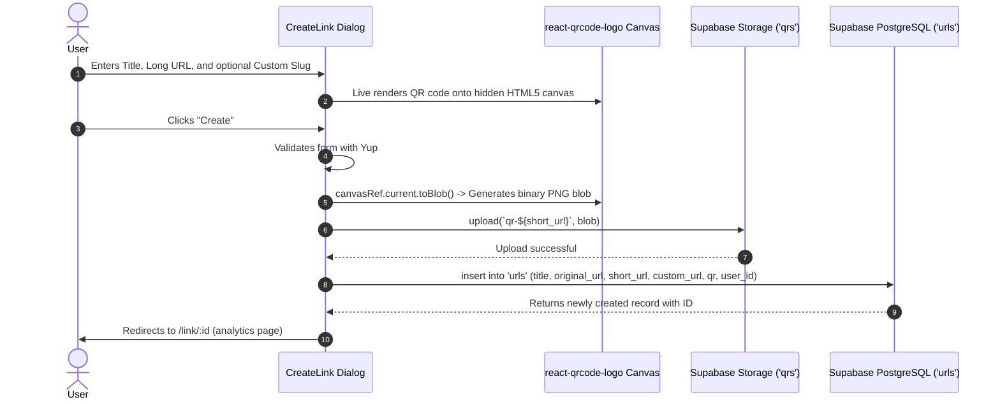
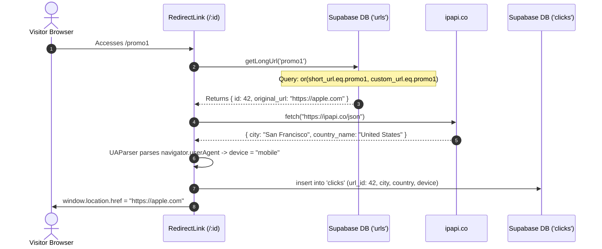
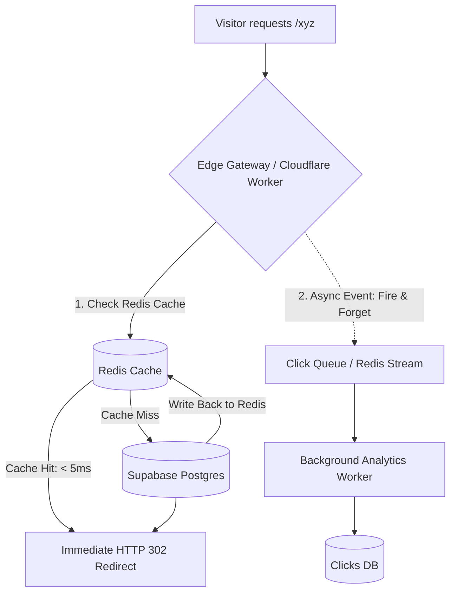

# 📘 Trimrr — Complete Codebase Architecture, Technical Explainer & Scalability Blueprint

Welcome to the definitive guide for the **Trimrr URL Shortener** codebase. This document is crafted to give you an exhaustive, crystal-clear understanding of:
1. **How the current codebase is structured and how every feature flows end-to-end.**
2. **How authentication, data fetching, and state management work under the hood.**
3. **Core technical concepts and terminology explained simply (including how shadcn/ui and its primitives work).**
4. **Current architectural bottlenecks and how to upgrade them to production-grade quality.**
5. **Modern technology integrations (especially Redis for sub-10ms caching, rate limiting, and click queues).**
6. **A roadmap of high-value future features to implement.**
7. **A battle-tested scalability blueprint for growing from 1,000 to 100,000,000+ requests per month.**

---

# Table of Contents
- [1. High-Level Architecture Overview](#1-high-level-architecture-overview)
- [2. End-to-End Application Flows](#2-end-to-end-application-flows)
  - [2.1 The Authentication Flow (Sign Up, Log In, Session Management)](#21-the-authentication-flow)
  - [2.2 The URL Creation & QR Code Pipeline](#22-the-url-creation--qr-code-pipeline)
  - [2.3 The Redirection & Click Tracking Flow](#23-the-redirection--click-tracking-flow)
  - [2.4 The Dashboard & Analytics Visualization Flow](#24-the-dashboard--analytics-visualization-flow)
- [3. Deep-Dive: File & Component Breakdown](#3-deep-dive-file--component-breakdown)
- [4. Demystifying the Terminology & Tech Stack](#4-demystifying-the-terminology--tech-stack)
  - [4.1 How shadcn/ui Really Works](#41-how-shadcnui-really-works)
  - [4.2 Radix UI Primitives & The `Slot` / `asChild` Pattern](#42-radix-ui-primitives--the-slot--aschild-pattern)
  - [4.3 Class Variance Authority (`cva`) and the `cn()` Utility](#43-class-variance-authority-cva-and-the-cn-utility)
  - [4.4 Supabase as a Backend-as-a-Service (BaaS)](#44-supabase-as-a-backend-as-a-service-baas)
  - [4.5 Yup Schema Validation](#45-yup-schema-validation)
  - [4.6 Canvas to Blob Conversion for QR Codes](#46-canvas-to-blob-conversion-for-qr-codes)
  - [4.7 User-Agent & Geolocation Tracking](#47-user-agent--geolocation-tracking)
- [5. Current Limitations & Transition to Production-Level](#5-current-limitations--transition-to-production-level)
  - [5.1 The Client-Side Redirection Bottleneck](#51-the-client-side-redirection-bottleneck)
  - [5.2 Moving Redirection to Edge Runtime / Serverless Middleware](#52-moving-redirection-to-edge-runtime--serverless-middleware)
- [6. Integrating Modern Technologies: The Redis Blueprint](#6-integrating-modern-technologies-the-redis-blueprint)
  - [6.1 Use Case 1: Sub-Millisecond Short URL Caching](#61-use-case-1-sub-millisecond-short-url-caching)
  - [6.2 Use Case 2: Distributed Rate Limiting (Token Bucket / Sliding Window)](#62-use-case-2-distributed-rate-limiting)
  - [6.3 Use Case 3: Asynchronous Click Ingestion Buffer (Redis Streams / BullMQ)](#63-use-case-3-asynchronous-click-ingestion-buffer)
  - [6.4 Use Case 4: Real-Time Counter & Unique Visitor Tracking (HyperLogLog)](#64-use-case-4-real-time-counter--unique-visitor-tracking)
- [7. Future Features Roadmap](#7-future-features-roadmap)
- [8. Scalability Blueprint (Handling 100M+ Clicks/Month)](#8-scalability-blueprint-handling-100m-clicksmonth)
  - [8.1 Base62 Short Code Generation vs Random Strings](#81-base62-short-code-generation-vs-random-strings)
  - [8.2 Database Indexing & Table Partitioning](#82-database-indexing--table-partitioning)
  - [8.3 Dedicated Analytics Store (ClickHouse vs PostgreSQL)](#83-dedicated-analytics-store)
  - [8.4 Global Edge Distribution & Anycast DNS](#84-global-edge-distribution--anycast-dns)

---

# 1. High-Level Architecture Overview

Trimrr is currently implemented as a **Single Page Application (SPA)** built with React 18, bundled with Vite, and powered by Supabase for database, authentication, and object storage:

```
[ User Browser ]
       │
       ├─► React Router DOM (v6 Data Router)
       │       │
       │       ├── Public Routes:  [/] LandingPage, [/auth] Auth, [/:id] RedirectLink
       │       └── Protected Routes: [/dashboard] Dashboard, [/link/:id] LinkPage
       │
       ├─► State & Async Layer
       │       ├── UrlProvider (React Context for global user session)
       │       └── useFetch (Custom Hook for loading, error, and response handling)
       │
       └─► Supabase Cloud Backend
               ├── Supabase Auth (GoTrue JWT session tokens)
               ├── Supabase Storage (Buckets: 'profile_pic', 'qrs')
               └── Supabase PostgreSQL (Tables: 'urls', 'clicks')
```

---

# 2. End-to-End Application Flows

Let's trace how the codebase operates during every user action.

---

## 2.1 The Authentication Flow

The authentication architecture is split across four core files:
1. `src/db/apiAuth.js`: Direct SDK calls to Supabase.
2. `src/context.jsx`: React Context wrapping the entire application to broadcast user state.
3. `src/components/require-auth.jsx`: Route guard preventing unauthorized access.
4. `src/pages/auth.jsx`, `src/components/login.jsx`, and `src/components/signup.jsx`: Presentation & form validation.

```mermaid
sequenceDiagram
    autonumber
    actor User as User
    participant Form as Login/Signup Component
    participant Hook as useFetch Hook
    participant AuthAPI as apiAuth.js
    participant Supabase as Supabase Auth & Storage
    participant Context as UrlContext (UrlState)
    participant Guard as RequireAuth Guard

    %% Signup Step
    rect rgb(20, 30, 48)
    note over User, Supabase: Sign Up Flow
    User->>Form: Enters Name, Email, Password, and selects Profile Pic
    Form->>Form: Validates schema with Yup
    Form->>Hook: fnSignup()
    Hook->>AuthAPI: signup({ name, email, password, profile_pic })
    AuthAPI->>Supabase: 1. storage.from('profile_pic').upload(filename, blob)
    Supabase-->>AuthAPI: File uploaded to public bucket
    AuthAPI->>Supabase: 2. auth.signUp({ email, password, data: { name, profile_pic_url } })
    Supabase-->>AuthAPI: Returns new User & Session token
    AuthAPI-->>Hook: Result received
    Form->>Context: fetchUser()
    Form->>User: Navigates to /dashboard
    end

    %% Session Load Step
    rect rgb(35, 45, 60)
    note over Context, Guard: App Boot & Session Guard
    Context->>AuthAPI: getCurrentUser() via supabase.auth.getSession()
    AuthAPI->>Supabase: Reads JWT session from browser localStorage
    Supabase-->>Context: Returns session.user
    Context->>Context: Sets isAuthenticated = user?.role === "authenticated"
    Guard->>Context: Checks { isAuthenticated, loading }
    alt Not Authenticated
        Guard->>User: Redirects to /auth
    else Authenticated
        Guard->>User: Renders Protected Children (Dashboard / LinkPage)
    end
    end
```



### Key Highlights of Current Auth:
- **Session Persistence**: Supabase stores JWT tokens in `localStorage`. When the page reloads, `getCurrentUser()` reads `supabase.auth.getSession()` synchronously from disk, eliminating login flicker.
- **Onboarding Link Query**: If an unauthenticated user enters a link on the landing page, Trimrr routes them to `/auth?createNew=https://...`. Once login or signup completes, the component checks `searchParams.get("createNew")` and forwards the user to `/dashboard?createNew=https://...`, automatically launching the creation dialog.

---

## 2.2 The URL Creation & QR Code Pipeline

Creating a shortened link involves client-side QR generation, image blob rendering, cloud storage upload, and database insertion.



1. **Random Slug Generation**: `apiUrls.js` creates a random 6-character alphanumeric slug via `Math.random().toString(36).substr(2, 6)`.
2. **Custom Alias Option**: If the user provides a custom alias (e.g. `summer-sale`), it is saved into `custom_url`.
3. **QR Generation on Canvas**: `<QRCode />` renders a standard 250x250 pixel canvas element. `canvas.toBlob(resolve)` converts the canvas pixels into an image file buffer in browser memory.
4. **Storage & URL Linkage**: The image is uploaded to Supabase Storage bucket `qrs`. Its public URL is stored in the `qr` column of the `urls` table.

---

## 2.3 The Redirection & Click Tracking Flow

When an end-user clicks a short link (e.g., `https://trimrr.in/promo1`):



---

## 2.4 The Dashboard & Analytics Visualization Flow

In `src/pages/dashboard.jsx` and `src/pages/link.jsx`:
- **Dashboard Aggregates**:
  - `getUrls(user_id)` fetches all links owned by the user.
  - `getClicksForUrls(urlIds)` performs an SQL `.in('url_id', urlIds)` query to calculate the aggregate click count across all user links.
- **Link Analytics (`/link/:id`)**:
  - `getClicksForUrl(url_id)` fetches all click rows for that specific link.
  - `location-stats.jsx`: Groups clicks by `city`, sums counts, and displays a responsive **Recharts LineChart** of the top 5 cities.
  - `device-stats.jsx`: Groups clicks by `device` (desktop, mobile, tablet) and displays an interactive **Recharts PieChart**.

---

# 3. Deep-Dive: File & Component Breakdown

| File Path | Primary Responsibility | Key Functions / Exports |
| :--- | :--- | :--- |
| `src/main.jsx` | React DOM mounting point | Mounts `<App />` into `#root` |
| `src/App.jsx` | Router configuration | Defines `createBrowserRouter` routes and wraps them in `<UrlProvider>` |
| `src/context.jsx` | Global Authentication State | `UrlProvider`, `UrlState()` context hook |
| `src/hooks/use-fetch.js` | Generic async execution wrapper | Exposes `{ data, loading, error, fn }` to standardize async operations |
| `src/db/supabase.js` | Supabase SDK initialization | Initializes `createClient` using `VITE_SUPABASE_URL` and `VITE_SUPABASE_KEY` |
| `src/db/apiAuth.js` | Authentication API operations | `login()`, `signup()`, `getCurrentUser()`, `logout()` |
| `src/db/apiUrls.js` | URL database operations | `getUrls()`, `getUrl()`, `getLongUrl()`, `createUrl()`, `deleteUrl()` |
| `src/db/apiClicks.js` | Click tracking & stats | `getClicksForUrls()`, `getClicksForUrl()`, `storeClicks()` |
| `src/pages/landing.jsx` | Marketing homepage | Hero section, URL input for quick onboarding, and FAQ accordion |
| `src/pages/auth.jsx` | Authentication view | Tabs switching between Login and Signup |
| `src/pages/dashboard.jsx` | Protected user portal | Overall stats cards, search/filter input, link list, link creation button |
| `src/pages/link.jsx` | Single link analytics view | QR display, download button, copy button, delete button, Recharts graphs |
| `src/pages/redirect-link.jsx`| Short link redirection handler | Fetches long URL, logs click analytics, and executes browser redirection |
| `src/components/create-link.jsx` | Modal dialog for creating short links | Form inputs, live QR canvas, Yup validation, canvas-to-blob conversion |
| `src/components/link-card.jsx` | Individual URL card in dashboard | Displays short/long URLs, copy-to-clipboard, QR download, and deletion |
| `src/components/location-stats.jsx` | Geographic visualization | Groups click records by city and renders Recharts `LineChart` |
| `src/components/device-stats.jsx` | Device breakdown visualization | Groups click records by device and renders Recharts `PieChart` |
| `src/components/require-auth.jsx` | Route guard component | Redirects unauthenticated visitors to `/auth` |
| `src/components/header.jsx` | Top navigation bar | Brand logo, login button or user avatar dropdown with logout action |
| `src/lib/utils.js` | Utility helper | `cn(...inputs)` combining `clsx` and `tailwind-merge` |

---

# 4. Demystifying the Terminology & Tech Stack

## 4.1 How shadcn/ui Really Works

A frequent question for developers new to modern React is: **"What exactly is shadcn/ui and how does it work?"**

### The Key Difference: Not an npm package!
Traditional UI libraries (like Material-UI or Ant Design) are installed as a compiled npm package dependency (`npm install @mui/material`). You are locked into their API, their bundled styles, and their component abstractions.

**shadcn/ui is completely different.** It is **not** a component library package. It is an **open-source code distribution system**:
1. You run a CLI tool (`npx shadcn-ui@latest add button`).
2. The CLI downloads the **raw source code** of the button directly into your project (`src/components/ui/button.jsx`).
3. **You own the code.** You can open `button.jsx`, change styles, add props, tweak accessibility, or delete parts you don't need.

### The 4 Pillars of shadcn/ui:
```
┌──────────────────────────────────────────────────────────┐
│                   shadcn/ui Architecture                 │
│                                                          │
│  [ Radix UI Primitives ]  --> Headless accessible logic  │
│             +                                            │
│  [ Tailwind CSS ]         --> Utility styling via tokens │
│             +                                            │
│  [ CVA (Variants) ]       --> Variant & size management  │
│             +                                            │
│  [ cn() Helper ]          --> Class merging & overrides  │
└──────────────────────────────────────────────────────────┘
```

---

## 4.2 Radix UI Primitives & The `Slot` / `asChild` Pattern

In `src/components/ui/button.jsx`:
```jsx
import { Slot } from "@radix-ui/react-slot";

const Button = React.forwardRef(({ className, variant, size, asChild = false, ...props }, ref) => {
  const Comp = asChild ? Slot : "button";
  return <Comp className={cn(buttonVariants({ variant, size, className }))} ref={ref} {...props} />;
});
```

### What is a "Headless" Component?
Radix UI provides **headless primitives** (Dropdowns, Dialogs, Accordions, Tabs). "Headless" means it has **100% of the functionality and accessibility** (WAI-ARIA compliance, keyboard arrow navigation, focus traps, screen-reader labels), but **0% styling**. You supply the styling via Tailwind.

### What is `asChild` and `Slot`?
Normally, a button component renders an HTML `<button>` tag:
```jsx
<Button>Click Me</Button>
// Renders: <button class="...">Click Me</button>
```

What if you want a Next.js / React Router link that looks like a button? In traditional HTML, nesting `<a><button>...</button></a>` is invalid HTML.
With Radix `Slot` and `asChild`:
```jsx
<Button asChild variant="destructive">
  <Link to="/auth">Go to Auth</Link>
</Button>
```
When `asChild = true`, `Slot` does **not** render a `<button>`. Instead, it merges the button's styling classes and click handlers directly onto its immediate child (`<Link>`), rendering clean, semantic HTML:
```html
<a href="/auth" class="bg-destructive text-destructive-foreground ...">Go to Auth</a>
```

---

## 4.3 Class Variance Authority (`cva`) and the `cn()` Utility

### What is `cva`?
`class-variance-authority` allows you to define declarative style variants for UI components:
```javascript
const buttonVariants = cva(
  "inline-flex items-center justify-center rounded-md text-sm font-medium", // Base styles
  {
    variants: {
      variant: {
        default: "bg-primary text-primary-foreground hover:bg-primary/90",
        destructive: "bg-destructive text-destructive-foreground hover:bg-destructive/90",
        ghost: "hover:bg-accent hover:text-accent-foreground",
      },
      size: {
        default: "h-10 px-4 py-2",
        sm: "h-9 rounded-md px-3",
        lg: "h-11 rounded-md px-8",
      },
    },
    defaultVariants: {
      variant: "default",
      size: "default",
    },
  }
);
```
Calling `buttonVariants({ variant: "destructive", size: "sm" })` automatically compiles and outputs the exact combination of Tailwind classes.

### What is `cn()` in `src/lib/utils.js`?
```javascript
import { clsx } from "clsx";
import { twMerge } from "tailwind-merge";

export function cn(...inputs) {
  return twMerge(clsx(inputs));
}
```
Why do we need both `clsx` and `tailwind-merge`?
1. **`clsx`**: Allows conditional classes:
   `clsx("btn", isActive && "active", isError ? "text-red-500" : "text-green-500")`
2. **`tailwind-merge`**: Solves Tailwind class conflicts.
   If a base button has `px-4` (padding 1rem), and a developer passes `className="px-8"`:
   - Without `twMerge`: Both `px-4` and `px-8` appear in the class list. CSS specificity rules decide which wins unpredictably.
   - With `twMerge`: `tailwind-merge` recognizes both control the same CSS property (`padding-left` and `padding-right`), removes `px-4`, and keeps only `px-8`!

---

## 4.4 Supabase as a Backend-as-a-Service (BaaS)

Supabase replaces traditional custom backend boilerplate by providing:
1. **Managed PostgreSQL**: A relational SQL database.
2. **PostgREST**: Automatically turns your Postgres tables and views into secure RESTful APIs (`supabase.from('urls').select('*')`).
3. **GoTrue (Auth)**: Manages signups, email confirmation, password hashing (bcrypt), and JSON Web Token (JWT) issuance.
4. **Storage**: S3-compatible file storage for media assets (profile avatars, QR images).
5. **Row Level Security (RLS)**: PostgreSQL policies that enforce data access at the database level:
   ```sql
   CREATE POLICY "Users can only see their own URLs"
   ON urls FOR SELECT
   USING (auth.uid() = user_id);
   ```

---

## 4.5 Yup Schema Validation

In `login.jsx`, `signup.jsx`, and `create-link.jsx`, **Yup** defines object schemas:
```javascript
const schema = yup.object().shape({
  title: yup.string().required("Title is required"),
  longUrl: yup.string().url("Must be a valid URL").required("Long URL is required"),
  customUrl: yup.string(),
});
```
- `validate(formData, { abortEarly: false })`: Validates all fields at once rather than stopping at the first error.
- Any validation failure throws an error containing `error.inner`, which maps each field name to its error message.

---

## 4.6 Canvas to Blob Conversion for QR Codes

In `src/components/create-link.jsx`:
```javascript
const canvas = ref.current.canvasRef.current;
const blob = await new Promise((resolve) => canvas.toBlob(resolve));
await fnCreateUrl(blob);
```
- `<QRCode />` draws pixels onto an HTML `<canvas>`.
- `canvas.toBlob()` converts those raw graphical pixels into a binary `Blob` (Binary Large Object) representing a compressed PNG file.
- This blob is then passed directly to `supabase.storage.upload()`, storing a permanent image file in the cloud.

---

## 4.7 User-Agent & Geolocation Tracking

In `src/db/apiClicks.js`:
1. **User-Agent Parsing (`ua-parser-js`)**:
   Reads `navigator.userAgent` (e.g., `"Mozilla/5.0 (iPhone; CPU iPhone OS 17_0 like Mac OS X)..."`) and parses it into structured hardware metadata (`res.type || "desktop"`).
2. **IP Geolocation (`ipapi.co`)**:
   Makes a `fetch("https://ipapi.co/json")` call from the visitor's browser to resolve latitude, longitude, city, and country from their public IP address.

---

# 5. Current Limitations & Transition to Production-Level

While the current codebase is clean and functional, there are several fundamental architecture limitations that must be addressed to reach production quality.

## 5.1 The Client-Side Redirection Bottleneck

In the current setup, when an end-user navigates to `trimrr.in/xyz`:
1. The browser requests `trimrr.in/xyz`.
2. The web server returns `index.html`.
3. The browser downloads the entire React bundle (several megabytes of JavaScript).
4. React initializes and mounts `<RedirectLink />`.
5. React calls Supabase to look up the URL in Postgres.
6. The browser makes an external HTTP request to `ipapi.co`.
7. React makes an insert query into Supabase's `clicks` table.
8. Only after all these steps finish does `window.location.href = originalUrl` execute.

### Why this is problematic:
- **High Latency**: The redirect takes **1,500ms to 3,500ms**. A production shortener (like Bitly or TinyURL) must redirect in **under 50ms**.
- **Social Media Crawlers Break**: Scrapers and bots (Twitter cards, Facebook OpenGraph, LinkedIn previews, Slack unfurls) do **not** execute JavaScript! They will see an empty loading spinner and fail to follow the link.
- **Third-Party API Rate Limits**: `ipapi.co` free tier is capped at 1,000 requests per day per IP. If multiple users share an IP or traffic spikes, requests fail. Ad-blockers also block `ipapi.co`.

---

## 5.2 Moving Redirection to Edge Runtime / Serverless Middleware

In a production architecture, redirection **never** runs inside a client-side React page. It runs at the **Edge** (e.g. Cloudflare Worker, Next.js Edge Middleware, or Fastify/Express Node.js gateway):



### Advantages of Edge Redirection:
1. **Instant Response**: Returns a native `HTTP 301` or `302 Moved Temporarily` response header directly to the browser in < 20ms.
2. **Built-in IP & Geo Data**: Edge platforms (like Cloudflare or Vercel) provide geolocation in request headers (`request.cf.city`, `request.cf.country`, `request.headers['x-forwarded-for']`) with **zero** external API calls!
3. **Bot & Crawler Friendly**: Scrapers immediately receive the redirect target.

---

# 6. Integrating Modern Technologies: The Redis Blueprint

**Redis (Remote Dictionary Server)** is an open-source, in-memory key-value data structure store. Because all data resides in RAM, read and write operations execute in **sub-millisecond speeds** (0.2ms - 2ms).

Here is how Redis transforms Trimrr into an enterprise-grade platform:

```
┌────────────────────────────────────────────────────────────────────────┐
│                        Redis In Trimrr Production                      │
│                                                                        │
│   1. URL Cache              2. Rate Limiting        3. Click Stream    │
│   GET link:promo           Sliding Window Log       XADD stream:clicks │
│   => Returns Target URL    10 req/min per IP        Non-blocking log   │
│   Time: ~1ms               Blocks scrapers/bots     Worker consumes    │
└────────────────────────────────────────────────────────────────────────┘
```

---

## 6.1 Use Case 1: Sub-Millisecond Short URL Caching

Instead of hitting PostgreSQL on every visit:

```typescript
// Sample Edge / Backend Link Resolver with Redis
import { Redis } from "@upstash/redis";

const redis = new Redis({
  url: process.env.UPSTASH_REDIS_REST_URL,
  token: process.env.UPSTASH_REDIS_REST_TOKEN,
});

export async function resolveUrl(slug: string): Promise<string | null> {
  const cacheKey = `link:${slug}`;

  // 1. Check in-memory cache
  const cachedUrl = await redis.get<string>(cacheKey);
  if (cachedUrl) {
    return cachedUrl; // Cache Hit! (< 5ms)
  }

  // 2. Cache Miss: Query PostgreSQL
  const { data, error } = await supabase
    .from("urls")
    .select("original_url")
    .or(`short_url.eq.${slug},custom_url.eq.${slug}`)
    .single();

  if (data?.original_url) {
    // 3. Write to Redis with a 24-hour TTL (Time To Live)
    await redis.set(cacheKey, data.original_url, { ex: 86400 });
    return data.original_url;
  }

  return null;
}
```

---

## 6.2 Use Case 2: Distributed Rate Limiting

To prevent bad actors, scrapers, and botnets from overwhelming the service or creating millions of spam links:

```typescript
// Redis Sliding Window Rate Limiter
export async function checkRateLimit(ip: string, limit = 20, windowSeconds = 60) {
  const key = `ratelimit:${ip}`;
  const current = await redis.incr(key);

  if (current === 1) {
    await redis.expire(key, windowSeconds);
  }

  if (current > limit) {
    throw new Error("Too many requests. Please try again later.");
  }
}
```

---

## 6.3 Use Case 3: Asynchronous Click Ingestion Buffer

In the current app, every click executes a synchronous database write (`await supabase.from('clicks').insert(...)`). When a link goes viral and receives 5,000 clicks per second, PostgreSQL connections will exhaust and crash.

With Redis:
1. When a user clicks a link, the redirect handler fires an **`XADD`** command to a Redis Stream (or `LPUSH` into a queue) taking less than 1ms, and immediately redirects the user.
2. A separate background worker reads from the stream in micro-batches (e.g. 500 records at a time) and performs bulk inserts into PostgreSQL or an analytics store.

```
Visitor ───► [Edge Worker] ──── 302 Redirect ────► Destination
                  │
                  ▼ (Takes 1ms)
             [Redis Stream]
                  │
                  ▼ (Consumes in batches of 500)
            [Background Worker]
                  │
                  ▼ (Batch Insert)
            [(Database)]
```

---

## 6.4 Use Case 4: Real-Time Counter & Unique Visitor Tracking

- **Atomic Counters (`INCR`)**: Increment click count instantly (`INCR link:clicks:42`) without expensive SQL table scans.
- **HyperLogLog (`PFADD`, `PFCOUNT`)**: Track unique visitors per URL using only 12KB of memory per URL, even for millions of distinct IP addresses!

---

# 7. Future Features Roadmap

Here are the highest-impact features to implement in upcoming development sessions:

### 1. Link Security & Controls
- **Password-Protected Links**: Users can set an optional password. Visitors see a sleek unlock screen before accessing the destination.
- **Expiration Dates & Auto-Disable**: Allow users to set a TTL (e.g. "Expires in 7 days" or "Expires after 500 clicks").
- **Custom 404 & Expired Link Pages**: Clean branded fallback page when a link has expired or been deleted.

### 2. Marketing & Campaign Tools
- **UTM Parameter Builder**: Built-in wizard to append `utm_source`, `utm_medium`, and `utm_campaign` to long URLs before shortening.
- **Custom Domain Branding (CNAME)**: Allow users to connect their own domains (e.g. `go.company.com/deal`).
- **Deep Linking / Device Routing**: Smart redirection — send iOS visitors to the Apple App Store, Android to Google Play, and desktop users to the website.

### 3. Developer & Power-User Tools
- **REST API & Developer Keys**: Allow programmatic shortening via an API token (`POST /api/v1/shorten`).
- **Bulk URL Shortener**: Drag-and-drop a CSV file to shorten hundreds of links at once and export the short URLs with QR codes.
- **Webhooks**: Notify external services (Slack, Discord, Zapier) when links hit milestone click counts (e.g., 10,000 clicks).

### 4. Advanced Analytics & Bot Filtering
- **Bot & Scraper Filtering**: Detect and flag search engine crawlers, social preview scrapers, and automated bots so click metrics reflect genuine human visitors.
- **Referrer Tracking**: Capture referring websites (Google, Twitter/X, Reddit, LinkedIn).
- **CSV & PDF Analytics Export**: One-click download of analytics reports for client presentations.

---

# 8. Scalability Blueprint (Handling 100M+ Clicks/Month)

If you plan to scale Trimrr into a commercial SaaS platform handling millions of daily visits, follow this systematic scaling plan:

```
                                  [ Cloudflare DNS / CDN ]
                                             │
                       ┌─────────────────────┴─────────────────────┐
                       ▼                                           ▼
             [ Region 1 Edge Worker ]                    [ Region 2 Edge Worker ]
                       │                                           │
                       ├───────────────► [ Upstash Redis ] ◄───────┤
                       │                  (Global Replica)         │
                       ▼                                           ▼
             [ Redis Click Stream ]                      [ Redis Click Stream ]
                       │                                           │
                       └─────────────────────┬─────────────────────┘
                                             ▼
                                 [ BullMQ / Kafka Worker ]
                                             │
                       ┌─────────────────────┴─────────────────────┐
                       ▼                                           ▼
            [ PostgreSQL / Supabase ]                     [ ClickHouse ]
            (User accounts, Auth, Links)           (Billions of Click Events)
```

---

## 8.1 Base62 Short Code Generation vs Random Strings

Currently, the app generates short URLs via:
```javascript
Math.random().toString(36).substr(2, 6);
```
**Why this breaks at scale:**
- `Math.random()` is pseudo-random and has a high collision rate as the database grows (Birthday Paradox).
- Querying the database to check if a random code already exists adds write latency.

### The Production Solution: Base62 Encoding of Sequential IDs
Base62 uses characters `[0-9a-zA-Z]` (62 possible characters).
- 6 characters in Base62 can represent $62^6 = 56,800,235,584$ unique links (over 56 billion links!).
- Using an auto-incrementing ID or a distributed **Twitter Snowflake ID**:

```javascript
const BASE62_CHARS = "0123456789abcdefghijklmnopqrstuvwxyzABCDEFGHIJKLMNOPQRSTUVWXYZ";

export function encodeBase62(num) {
  let str = "";
  while (num > 0) {
    str = BASE62_CHARS[num % 62] + str;
    num = Math.floor(num / 62);
  }
  return str.padStart(6, "0");
}
```
**Benefits:**
- **Zero collisions**: Every unique integer produces a unique short slug.
- **Zero collision check queries**: Instant insert performance.

---

## 8.2 Database Indexing & Table Partitioning

Ensure the PostgreSQL database has the proper B-Tree indexes:

```sql
-- Fast index for short code and custom slug lookups
CREATE UNIQUE INDEX idx_urls_short_url ON urls (short_url);
CREATE UNIQUE INDEX idx_urls_custom_url ON urls (custom_url) WHERE custom_url IS NOT NULL;

-- Fast index for fetching user's links
CREATE INDEX idx_urls_user_id ON urls (user_id);

-- Fast index for fetching clicks belonging to a URL
CREATE INDEX idx_clicks_url_id_created ON clicks (url_id, created_at DESC);
```

### Table Partitioning:
When the `clicks` table grows to 50M+ rows, table scans degrade. Partition the table by `created_at` (e.g., monthly partitions) so queries only scan the relevant month's partition.

---

## 8.3 Dedicated Analytics Store (ClickHouse vs PostgreSQL)

Relational databases like PostgreSQL are row-oriented and optimized for transactional operations (OLTP). When running analytical queries like:
```sql
SELECT city, count(*) FROM clicks WHERE url_id = 42 GROUP BY city;
```
over millions of records, PostgreSQL must load entire rows into memory.

For production scale:
- Keep **PostgreSQL** for user accounts, authentication, and URL metadata.
- Stream click events into **ClickHouse** (an ultra-fast columnar OLAP database). ClickHouse can aggregate 100,000,000 rows in less than 50 milliseconds!

---

## 8.4 Global Edge Distribution & Anycast DNS

- Use **Cloudflare** or **Fastly** for Anycast DNS routing so DNS resolution happens at the closest data center to the visitor.
- Deploy edge redirect logic to Cloudflare Workers across 300+ cities worldwide.
- With Redis globally replicated (e.g. Upstash Global Database), redirects resolve in **sub-15 milliseconds anywhere on Earth**.

---

# 🎯 Summary & Next Steps

You now possess a complete 360-degree blueprint of the Trimrr codebase:
- **Understand the current stack**: React 18, Vite, Tailwind, shadcn/ui, and Supabase.
- **Know the internal mechanics**: How Radix UI primitives, CVA, `cn()`, and Supabase session management interact.
- **Have a clear path to production**: Replace client-side redirects with Edge Middleware, integrate Redis for caching & rate limiting, buffer clicks with message queues, and adopt Base62 slug generation.

Happy building, and welcome to engineering at scale! 🚀

