# 🚀 Trimrr — Modern Full-Stack URL Shortener & Analytics Platform

Trimrr is a feature-rich, high-performance URL shortening web application built with **React 18**, **Vite**, **Tailwind CSS**, **shadcn/ui**, and powered by **Supabase** (PostgreSQL, Authentication & Storage). It allows users to turn long URLs into clean, customizable short links, generate instant downloadable QR codes, and track real-time audience analytics (geolocations, device breakdowns, and total clicks).

---

## 📸 Overview & Features

- **⚡ Fast URL Shortening**: Convert long URLs into concise, branded short links (`/xyz` or custom slug).
- **🎨 Custom Slugs & Branded URLs**: Choose custom alias endpoints for marketing campaigns.
- **📱 Instant QR Code Generation**: Dynamically creates customizable QR codes downloadable in PNG format.
- **📊 Real-time Click Analytics**:
  - Total click counts per link and aggregate account clicks.
  - Geolocation detection (city & country) visualized using interactive line charts (`Recharts`).
  - Device type detection (desktop, mobile, tablet) using user-agent parsing and pie charts.
- **🔐 Secure Authentication**: Email/password authentication, persistent sessions, and profile avatar uploads backed by Supabase Auth and Storage.
- **🛡️ Route Protection**: Protected routes (`/dashboard`, `/link/:id`) with immediate redirection for unauthenticated visitors.
- **🎯 Dynamic Query Onboarding**: Paste a link on the landing page while logged out — Trimrr remembers your input and immediately opens the creation modal once authenticated.
- **✨ Polished Modern UI**: Built with Tailwind CSS, Radix UI primitives, and shadcn/ui design tokens.

---

## 🛠️ Tech Stack & Architecture

| Layer | Technology | Description |
| :--- | :--- | :--- |
| **Frontend Framework** | [React 18](https://react.dev/) | Component-driven declarative UI library |
| **Build Tool & Bundler** | [Vite 5](https://vitejs.dev/) | Ultra-fast development server and optimized production build |
| **Routing** | [React Router v6](https://reactrouter.com/) | Client-side routing with `createBrowserRouter` |
| **Styling & UI** | [Tailwind CSS](https://tailwindcss.com/) & [shadcn/ui](https://ui.shadcn.com/) | Accessible, composable UI components with Radix Primitives |
| **Icons & Loaders** | [Lucide React](https://lucide.dev/) & [React Spinners](https://www.npmjs.com/package/react-spinners) | Clean vector icons and animated progress loaders |
| **Backend & Database** | [Supabase](https://supabase.com/) | Managed PostgreSQL database, Row Level Security, and REST APIs |
| **Auth & Storage** | [Supabase Auth & Storage](https://supabase.com/docs) | User session management and object storage for QR codes & avatars |
| **Form Validation** | [Yup](https://github.com/jquense/yup) | Robust schema-based form validation |
| **Data Visualization** | [Recharts](https://recharts.org/) | Declarative charting library for geographic and device statistics |
| **Device & IP Parsing** | [ua-parser-js](https://faisalman.github.io/ua-parser-js/) & [ipapi](https://ipapi.co/) | User-Agent parsing and IP geolocation lookup |

---

## 📂 Project Structure

```text
URL_SHORTNER_MAIN/
├── public/                 # Static assets (logos, banners, public images)
├── src/
│   ├── components/         # Reusable application components
│   │   ├── ui/             # shadcn/ui atomic components (button, card, dialog, etc.)
│   │   ├── create-link.jsx # Modal dialog for creating links and rendering QR code
│   │   ├── device-stats.jsx# Pie chart for device type breakdown (Desktop/Mobile)
│   │   ├── error.jsx       # Standardized error banner display
│   │   ├── header.jsx      # Navigation bar with user avatar and dropdown menu
│   │   ├── link-card.jsx   # Dashboard item card with copy, download QR, and delete
│   │   ├── location-stats.jsx # Line chart for top geographic click locations
│   │   ├── login.jsx       # Login form with Yup validation
│   │   ├── require-auth.jsx# Route wrapper guard for authenticated pages
│   │   └── signup.jsx      # Signup form with avatar upload
│   ├── db/                 # Supabase client & API integration queries
│   │   ├── apiAuth.js      # Auth methods (login, signup, getCurrentUser, logout)
│   │   ├── apiClicks.js    # Clicks queries & storeClicks geolocation logger
│   │   ├── apiUrls.js      # URLs queries (get, list, create, delete, resolve)
│   │   └── supabase.js     # Supabase client initialization
│   ├── hooks/
│   │   └── use-fetch.js    # Custom async hook managing loading, error, and data state
│   ├── layouts/
│   │   └── app-layout.jsx  # Main shell containing Header, Outlet, and Footer
│   ├── lib/
│   │   └── utils.js        # `cn` helper combining clsx and tailwind-merge
│   ├── pages/
│   │   ├── auth.jsx        # Authentication page with Login/Signup tabs
│   │   ├── dashboard.jsx   # User dashboard displaying total stats and link list
│   │   ├── landing.jsx     # Landing page with hero input and FAQ accordion
│   │   ├── link.jsx        # Individual link analytics & management page
│   │   └── redirect-link.jsx # Dynamic redirection endpoint for short URLs
│   ├── App.jsx             # Route definitions & router configuration
│   ├── context.jsx         # Global UrlContext providing auth session state
│   ├── index.css           # Tailwind base styles and CSS variables
│   └── main.jsx            # Application entry point
├── components.json         # shadcn/ui configuration
├── tailwind.config.js      # Tailwind design system configuration
├── vite.config.js          # Vite build config with path aliases (`@`)
├── package.json            # Dependencies and npm scripts
└── CODEBASE_GUIDE.md       # Comprehensive deep-dive & scalability blueprint
```

---

## ⚡ Getting Started

### 1. Prerequisites
Ensure you have the following installed:
- [Node.js](https://nodejs.org/) (v18.x or later)
- [npm](https://www.npmjs.com/) or [yarn](https://yarnpkg.com/)
- A free [Supabase](https://supabase.com/) account

### 2. Clone the Repository
```bash
git clone <repository-url>
cd URL_SHORTNER_MAIN
```

### 3. Install Dependencies
```bash
npm install
```

### 4. Supabase Database Setup
Create a new Supabase project and execute the following SQL scripts in the Supabase **SQL Editor**:

```sql
-- 1. Create the URLs table
CREATE TABLE urls (
  id BIGINT GENERATED ALWAYS AS IDENTITY PRIMARY KEY,
  created_at TIMESTAMP WITH TIME ZONE DEFAULT NOW(),
  title TEXT NOT NULL,
  original_url TEXT NOT NULL,
  short_url TEXT NOT NULL UNIQUE,
  custom_url TEXT UNIQUE,
  user_id UUID REFERENCES auth.users(id) ON DELETE CASCADE,
  qr TEXT
);

-- 2. Create the Clicks table
CREATE TABLE clicks (
  id BIGINT GENERATED ALWAYS AS IDENTITY PRIMARY KEY,
  created_at TIMESTAMP WITH TIME ZONE DEFAULT NOW(),
  url_id BIGINT REFERENCES urls(id) ON DELETE CASCADE,
  city TEXT,
  country TEXT,
  device TEXT
);

-- 3. Storage Buckets:
-- Go to Supabase Dashboard -> Storage and create 2 PUBLIC buckets:
-- 1. 'profile_pic' (for user avatars)
-- 2. 'qrs' (for generated QR code images)
```

### 5. Configure Environment Variables
Create a `.env` file in the root directory:

```env
VITE_SUPABASE_URL=https://your-project-id.supabase.co
VITE_SUPABASE_KEY=your-supabase-anon-key
```

### 6. Run Development Server
```bash
npm run dev
```
Open your browser and navigate to `http://localhost:5173`.

### 7. Production Build
```bash
npm run build
npm run preview
```

---

## 🔄 Core User Flows

```mermaid
sequenceDiagram
    autonumber
    actor User as User Browser
    participant App as React App (Vite)
    participant Ctx as UrlContext & useFetch
    participant SB as Supabase (Postgres & Storage)
    participant IP as ipapi.co (Geo API)

    %% Flow 1: Shorten URL
    rect rgb(30, 41, 59)
    note right of User: 1. Creating a Short Link
    User->>App: Submits URL + Title + Optional Custom Slug
    App->>App: Generates Canvas QR Code via react-qrcode-logo
    App->>SB: Uploads QR blob to Storage bucket ('qrs')
    SB-->>App: Returns public image URL
    App->>SB: Inserts into 'urls' table (title, original_url, short_url, custom_url, qr)
    SB-->>App: Returns created record
    App->>User: Navigates to /link/:id with analytics & copy link
    end

    %% Flow 2: Redirection
    rect rgb(15, 23, 42)
    note right of User: 2. Visiting Short URL (/:id)
    User->>App: Navigates to short link (e.g. /my-promo)
    App->>SB: getLongUrl(id) -> Query by short_url or custom_url
    SB-->>App: Returns { id, original_url }
    App->>IP: fetch("https://ipapi.co/json") -> Detects City, Country
    App->>App: UAParser parses User-Agent -> Detects Device
    App->>SB: Inserts click record into 'clicks' (url_id, city, country, device)
    App->>User: window.location.href = original_url (Redirect)
    end
```



---

## 📖 Deep-Dive & Architecture Documentation

For a detailed breakdown of:
- **How Authentication works under the hood** (Supabase Auth sessions, token persistence, context flow).
- **How shadcn/ui works** (Radix UI headless components, Tailwind CSS variables, CVA, and the `cn()` utility).
- **Production-readiness upgrades** (moving from client-side redirects to Edge Middleware).
- **Redis caching & rate limiting architecture** (sub-10ms redirects, DDoS protection).
- **Scalability blueprint** for handling 100M+ clicks/month.

👉 Read the full guide in [CODEBASE_GUIDE.md](file:///g:/Projects/NEW_GEN/URL_SHORTNER_MAIN/CODEBASE_GUIDE.md).

---

## 📜 License
This project is open-source and available under the [MIT License](LICENSE).

